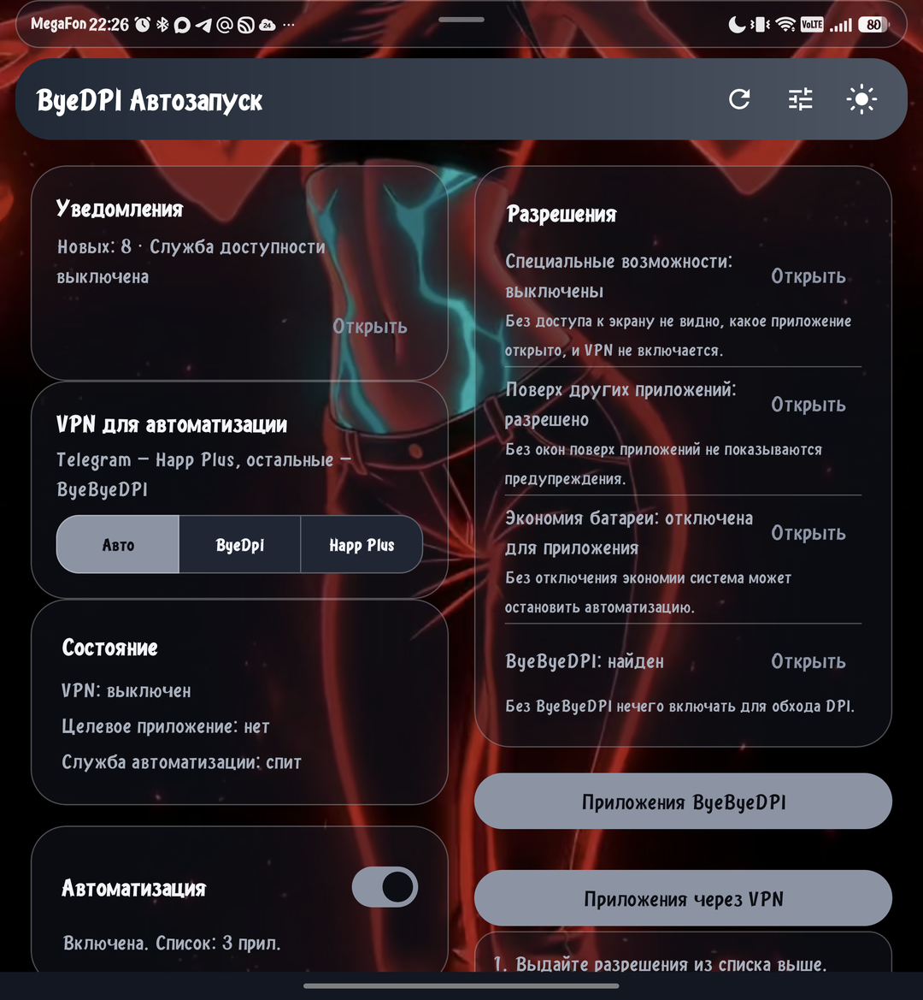
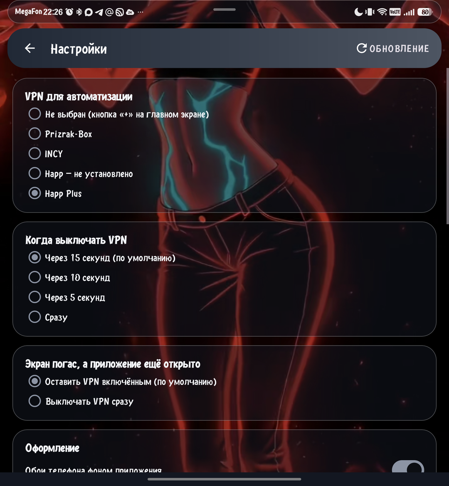
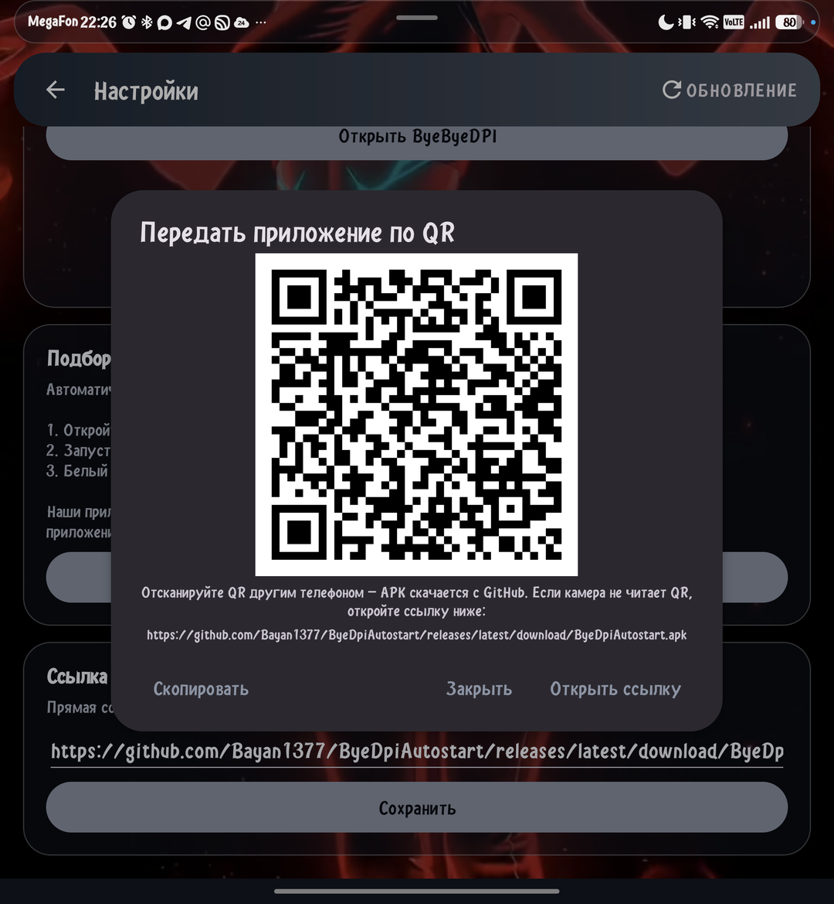

# ByeDPI Автозапуск

Android-приложение, которое автоматически включает VPN при открытии выбранных программ и
выключает его после выхода. Помогает не держать VPN постоянно включённым и не тратить батарею.

**[Скачать APK](https://github.com/Bayan1377/ByeDpiAutostart/releases/latest/download/ByeDpiAutostart.apk)** ·
**[Все релизы](https://github.com/Bayan1377/ByeDpiAutostart/releases)** ·
**[Как собрать](BUILDING.md)**

| Главный экран | Настройки VPN | QR для передачи |
|---|---|---|
|  |  |  |

## Возможности

- **Автозапуск VPN по приложению** — открыли YouTube, Instagram, Telegram или другое
  выбранное приложение, VPN поднимается; вышли — выключается.
- **Три режима работы:**
  - **Авто** — Telegram идёт через «Призрак», приложения из VPN-списка — через выбранный VPN,
    остальные — через ByeByeDPI;
  - **ByeDpi** — все выбранные приложения через ByeByeDPI;
  - **Свой VPN** — приложения из VPN-списка через выбранный VPN.
- **Два независимых списка приложений:** «Приложения ByeByeDPI» и «Приложения через VPN».
  Приложение не может находиться в обоих списках одновременно.
- **Поддержка нескольких VPN** с управлением без открытия интерфейса.
- **Уведомления о проблемах:** VPN не поднялся, нет интернета, не проходит проверка стратегии,
  выключена служба доступности.
- **Оформление:** светлая/тёмная тема, 6 цветовых палитр, прозрачность карточек до 90%,
  обои телефона фоном.
- **Передача приложения:** «Поделиться APK» и QR-код со ссылкой на GitHub.
- **Проверка обновлений:** кнопка «Обновление» в настройках и автоматическая проверка один раз
  при запуске.

## Поддерживаемые VPN

| VPN | Пакет | Как управляется |
|---|---|---|
| **ByeByeDPI** | `io.github.romanvht.byedpi` | локальный обход DPI, запуск/остановка |
| **Призрак Box** | `ru.legiz.prizrakbox.meta` | внешние действия `START`/`STOP` |
| **INCY** | `llc.itdev.incy` | broadcast `CONNECT`/`DISCONNECT` |
| **Happ** | `su.happ.proxyutility`, `com.happproxy` | deep link `happ://connect_without_ui` |
| **Happ Plus** | `com.happ.plushap` | автоматизация кнопки питания |

ByeByeDPI — обязательная основа: без него приложению нечем поднимать обход DPI. Остальные VPN
нужны только для приложений из списка «Приложения через VPN».

Если поддерживаемый VPN не установлен, в настройках он всё равно виден с пометкой
**«не установлено»**. Нажатие открывает страницу загрузки:

- [Призрак Box](https://github.com/legiz-ru/Prizrak-Box/releases/latest)
- [INCY](https://github.com/INCY-DEV/incy-platforms/releases/latest)
- [Happ](https://github.com/Happ-proxy/happ-android/releases/latest)
- [Happ Plus](https://happ.living/plus/download)

## Как это работает

1. Служба доступности сообщает приложению, какое приложение сейчас на экране.
2. Если оно есть в выбранном списке, приложение запускает нужный VPN с заданной задержкой.
3. После выхода из приложения VPN останавливается — сразу или через выбранное время.
4. Служба-сторож поддерживает автоматизацию, даже если главный экран закрыт.

Приложение не является VPN-сервером и не даёт подписку. Оно только управляет установленными
VPN-приложениями.

## Установка

1. Скачайте APK по ссылке выше.
2. Откройте файл на телефоне.
3. Разрешите установку из этого источника, если Android попросит.
4. Запустите приложение и выдайте разрешения из карточки **«Разрешения»**.

Требования: **Android 8.0+**. Тестировалось на HONOR Magic V6 (Android 17) и MagicOS 11;
на других прошивках названия пунктов настроек могут отличаться.

### Разрешения

| Разрешение | Зачем нужно | Без него |
|---|---|---|
| **Специальные возможности** | видеть, какое приложение открыто | VPN не включается автоматически |
| **Поверх других приложений** | показывать предупреждения | не будет видно важных сообщений |
| **Экономия батареи** | не дать системе остановить службу | автоматизация может засыпать |
| **Уведомления** | сообщения о проблемах VPN | предупреждения не появятся |
| **Установка неизвестных приложений** | обновление APK | не получится обновить приложение |

## Настройки

- **VPN для автоматизации** — режим и выбор VPN.
- **Когда выключать VPN** — задержка после выхода: 15, 10, 5 секунд или сразу.
- **Экран погас** — оставить VPN включённым или выключить.
- **Оформление** — обои, тёмная тема, палитра, прозрачность карточек.
- **Приложение и ByeByeDPI** — открыть ByeByeDPI, поделиться APK, QR, сброс списков.
- **Обновление** — маленькая кнопка в шапке настроек.

## Сборка

Нужны JDK 17, Android SDK 34 и Gradle 8.7:

```bat
gradle assembleDebug
```

APK появится в `app/build/outputs/apk/debug/app-debug.apk`.

Ключ подписи и `keystore.properties` в репозиторий не входят. Подробнее — в
[BUILDING.md](BUILDING.md).

## Приватность

- Нет аккаунтов, рекламы и аналитики.
- Настройки и списки приложений хранятся только на телефоне.
- В интернет приложение обращается только для проверки обновлений на GitHub.
- QR-код ведёт на публичный APK в GitHub; локальный Wi-Fi-сервер используется только если
  ссылка на GitHub очищена вручную.

## Ограничения

- Автоматическое определение приложения зависит от службы доступности и поведения прошивки.
- Производители VPN могут менять способы управления; поддержка конкретной версии VPN не
  гарантируется.
- Android всегда требует подтверждения установки APK — тихая установка невозможна.
- Happ Plus управляется через автоматизацию интерфейса, поэтому его обновление может потребовать
  правки приложения.

## Версия

Текущая версия — **1.30**. История изменений — в
[релизах](https://github.com/Bayan1377/ByeDpiAutostart/releases) и [CODE-LOG.md](CODE-LOG.md).
